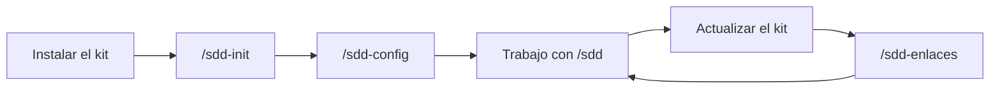
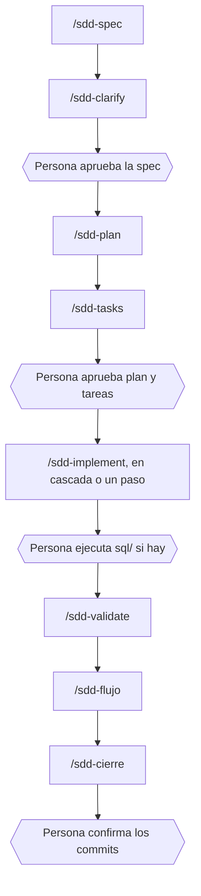
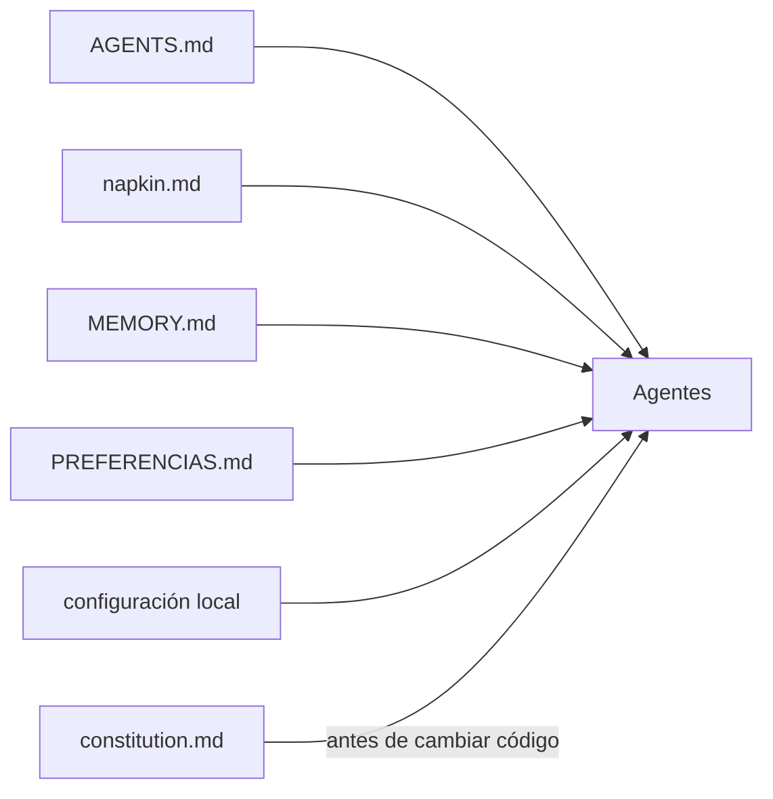

# agent-kit — flujo SDD con fuente de verdad `AGENTS.md`

Kit genérico (en español) para que cualquier proyecto trabaje con agentes de IA bajo un mismo
esquema de Spec-Driven Development. **`AGENTS.md`** es la fuente de verdad; **`.agents/`** reúne
agentes, comandos y skills; **`.docs/`** guarda la constitución, los planes y la deuda técnica.
Funciona con Claude Code, Cursor, OpenCode y otras herramientas que lean `AGENTS.md`: las
carpetas de cada herramienta se enlazan a `.agents/` (ver `/sdd-enlaces`).

## Flujo general

De la instalación al día a día del kit en un proyecto:



1. Instalar el kit en el proyecto (ver «Instalar»).
2. `/sdd-init`: personaliza `AGENTS.md`, constitución, napkin y memoria (una sola vez).
3. `/sdd-config`: configuración de cada dev (modelos, subagentes, entornos, presentación).
4. Trabajo con `/sdd <petición>` o con los comandos de fase.
5. Actualizar el kit cuando salga una versión nueva (ver «Actualizar»).
6. `/sdd-enlaces`: revisa los enlaces hacia las carpetas de tus herramientas y vuelve al paso 4.

## Ciclo de un requerimiento

Cada requerimiento vive en una carpeta de `.docs/002_specs/`. Las puertas de aprobación son de la
persona; los agentes no las cruzan solos.



- **Completo**: todos los pasos del diagrama.
- **Ligero** (cambios chicos): sin `02`, `03` ni `06`; el plan va dentro de `04_tasks.md` y se
  saltan `/sdd-plan` y `/sdd-flujo`. Mantiene las puertas de spec y tareas. Condiciones:
  [`topes-y-modos.md`](template/.agents/skills/sdd/topes-y-modos.md) › «Modo ligero».

| Documento | Qué es |
|---|---|
| `01_spec.md` | Qué se necesita (requisitos, casos límite, criterios) |
| `02_analisis_impacto.md` | Qué toca y qué depende (solo completo) |
| `03_plan.md` | Cómo se hará (solo completo) |
| `04_tasks.md` | Fases y pasos verificables con su «Hecho cuando» |
| `05_avance.md` | Estado, tiempos y punto de retomo |
| `06_flujo.md` | Flujo operativo de lo implementado (solo completo) |
| `07_casos_prueba.md` | Casos de prueba y corridas (opcional; los ejecuta `tester`) |

Detalle y numeración: [`template/.docs/002_specs/README.md`](template/.docs/002_specs/README.md).

## Qué contiene `template/`

```
AGENTS.md  CLAUDE.md  MEMORY.md  .gitignore
.agents/
  README.md  napkin.md  sync-agents.md  validar-estructura.md  catalogo-skills.md
  configuracion.ejemplo.md  entornos.ejemplo.md  preferencias.ejemplo.md
  agents/    coordinator, planner, implementer, reviewer, tester, explore, auxiliar
  commands/  sdd, sdd-init, sdd-config, sdd-spec, -clarify, -plan, -tasks, -implement,
             -validate, -flujo, -cierre, -change, -status, -pausa, -version,
             -constitucion, -enlaces, -estructura
  skills/    sdd (+ plantillas, avance y tiempos), napkin, git-commit, formato-respuesta,
             adr, migracion-bd, seguridad-basica, bitacora-uso
.docs/
  001_constitucion/  002_specs/ (índice)  003_deuda/ (índice)  004_adr/ (índice)
  005_contexto/ (índice)
```

Vista de un proyecto con el kit ya instalado (lo marcado como local lo excluye `.gitignore`):

```
mi-proyecto/
├── AGENTS.md                            # fuente de verdad para todos los agentes
├── CLAUDE.md                            # apunta a AGENTS.md
├── MEMORY.md                            # decisiones y trampas vigentes
├── .gitignore                           # excluye lo local y los enlaces por herramienta
├── PREFERENCIAS.md                      # preferencias personales (local, no se versiona)
├── src/ …                               # tu código
├── .agents/
│   ├── agents/                          # roles: coordinator, planner, implementer, reviewer, tester, explore, auxiliar
│   ├── commands/                        # comandos /sdd*
│   ├── skills/                          # skills del kit
│   ├── README.md                        # roles y comandos
│   ├── napkin.md                        # runbook vivo del repo
│   ├── sync-agents.md                   # enlaces por herramienta
│   ├── validar-estructura.md            # chequeo de estructura
│   ├── catalogo-skills.md               # catálogo de skills
│   ├── *.ejemplo.md                     # plantillas de configuración, entornos y preferencias
│   ├── .kit-version                     # versión del kit instalada
│   ├── .kit-origen                      # url y rama del kit de origen
│   └── local/                           # (local, no se versiona)
│       ├── configuracion.md             # configuración de cada dev (`/sdd-config`)
│       └── entornos.md                  # destinos de QA
├── .claude/                             # (local, no se versiona) enlaces a .agents/
├── .cursor/                             # (local, no se versiona) enlaces a .agents/
├── .opencode/                           # (local, no se versiona) enlaces a .agents/
└── .docs/
    ├── 001_constitucion/
    │   └── constitution.md              # reglas del proyecto
    ├── 002_specs/
    │   ├── README.md                    # índice de specs y numeración
    │   └── 0001_ExportarFacturas/       # ejemplo de una spec
    │       ├── 01_spec.md
    │       ├── 02_analisis_impacto.md   # solo modo completo
    │       ├── 03_plan.md               # solo modo completo
    │       ├── 04_tasks.md
    │       ├── 05_avance.md
    │       ├── 06_flujo.md              # solo modo completo
    │       ├── 07_casos_prueba.md       # opcional
    │       └── sql/                     # opcional, si hay cambios de datos
    ├── 003_deuda/                       # índice de deuda técnica
    ├── 004_adr/                         # decisiones de arquitectura
    └── 005_contexto/                    # contexto del proyecto bajo demanda
```

En la raíz del kit, fuera de `template/` (no se copian al instalar):

```
INSTALAR.md      procedimiento de instalación
ACTUALIZAR.md    procedimiento para actualizar un proyecto que ya tiene el kit
manifiestos/     huellas por versión; no se distribuye
```

## Instalar

El kit no trae scripts (dependen del SO y del shell). Resumen:

1. Abre esta carpeta con tu agente.
2. Pídele: **"instala el kit en `<ruta del proyecto>` siguiendo `INSTALAR.md`"**.
3. El agente detecta tu SO y shell, te ofrece un script a tu medida o el paso a paso, y copia
   `template/` sin sobrescribir nada.
4. Abre el proyecto y corre `/sdd-init`.

Procedimiento completo, también a mano: [`INSTALAR.md`](INSTALAR.md). Si el proyecto ya tiene el
kit, no lo instales otra vez: ver «Actualizar». Si abres el propio clon del kit, el agente
pregunta si lo quieres para un proyecto nuevo o para trabajar el kit (modo mantenimiento, que
conserva sus specs, ADR y memoria).

## Configurar

Mientras `AGENTS.md` marque instalación pendiente, los agentes piden `/sdd-init` antes de otro
comando `/sdd*`. Cada pieza de configuración:

| Pieza | Qué es | Quién la escribe | Versionada |
|---|---|---|---|
| `/sdd-init` | Entrevista (máx. 6 preguntas) que rellena `AGENTS.md`, constitución, napkin y `MEMORY.md` | El agente, con tu aprobación | Sí |
| `/sdd-config` | Asistente por dev: modelos, subagentes, clarify, entornos, presentación | El agente, con tu confirmación | No |
| `/sdd-enlaces` | Crea o corrige los enlaces hacia `.claude/`, `.cursor/`, `.opencode/` | El agente, con tu confirmación | No (locales) |
| `/sdd-constitucion` | Propone o revisa los principios innegociables | El agente, con tu aprobación | Sí |
| `PREFERENCIAS.md` | Directivas personales según tu entorno (plantilla: [`preferencias.ejemplo.md`](template/.agents/preferencias.ejemplo.md)) | Cada dev | No (`.gitignore`) |
| `.agents/local/configuracion.md` | Resultado de `/sdd-config` (plantilla: [`configuracion.ejemplo.md`](template/.agents/configuracion.ejemplo.md)) | `/sdd-config` o cada dev | No |
| Bitácora de uso (beta) | Registro local por dev de tiempos y tokens; apagada por omisión, se activa con `/sdd-config`; sirve para levantar issues de rendimiento con datos reales | `/sdd-config` y los comandos `/sdd*` | No |
| `.agents/local/entornos.md` | Destinos permitidos para las pruebas de QA (plantilla: [`entornos.ejemplo.md`](template/.agents/entornos.ejemplo.md)) | Cada dev | No |

Quién lee qué:



Los enlaces de las herramientas se explican en
[`sync-agents.md`](template/.agents/sync-agents.md).

## Ejemplo de uso

Un requerimiento de punta a punta (el número y el nombre son ilustrativos):

```
/sdd-spec 0001_ExportarFacturas exportar las facturas del mes a CSV
/sdd-clarify 0001_ExportarFacturas      # QA de la spec; resuelves las dudas y apruebas
/sdd-plan 0001_ExportarFacturas         # análisis de impacto y plan
/sdd-tasks 0001_ExportarFacturas        # fases y pasos; apruebas las tareas
/sdd-implement 0001_ExportarFacturas      # cascada: todos los pasos, en lotes
/sdd-implement 0001_ExportarFacturas F1.1 # o un solo paso
/sdd-validate 0001_ExportarFacturas     # RF por RF
/sdd-cierre 0001_ExportarFacturas       # confirmas los commits
```

Atajo: `/sdd <petición>` y el coordinator decide la fase. `/sdd-status` dice dónde estás y
`/sdd-pausa` deja el punto de retomo.

## Actualizar

1. `/sdd-version` consulta el origen del kit y dice si hay versión nueva (solo lee).
2. Sigue [`ACTUALIZAR.md`](ACTUALIZAR.md): solo se reemplazan archivos KIT-VIEJO confirmados,
   nunca lo que personalizaste.
3. Después, corre `/sdd-enlaces` para revisar enlaces y réplicas.

## Comandos y roles

Fuente: [`template/.agents/README.md`](template/.agents/README.md) › «Roles y comandos». Las
reglas de cada uno viven en su archivo.

| Comando | Para qué |
|---|---|
| `/sdd` | Entrada única: el coordinator interpreta la petición y decide la fase |
| `/sdd-init` | Personaliza el kit en un proyecto nuevo (una sola vez) |
| `/sdd-config` | Asistente de configuración de cada dev (repetible) |
| `/sdd-spec` | Entrevista y genera `01_spec.md` |
| `/sdd-clarify` | Revisa la spec como QA (solo detecta) |
| `/sdd-plan` | Genera análisis de impacto y plan de una spec aprobada |
| `/sdd-tasks` | Divide el plan en fases y pasos verificables |
| `/sdd-implement` | Implementa `04_tasks.md` en cascada (todo o una fase) o un solo paso |
| `/sdd-validate` | Valida la spec RF por RF |
| `/sdd-flujo` | Genera `06_flujo.md` de lo implementado |
| `/sdd-cierre` | Cierra el feature (previa, resultados, descarte, reapertura) |
| `/sdd-change` | Cambio de requisito: primero la spec |
| `/sdd-status` | Fase, avance, horas y siguiente paso de un feature |
| `/sdd-pausa` | Deja el punto de retomo y la lista «al retomar» |
| `/sdd-version` | ¿Tengo la última versión del kit? (solo lee) |
| `/sdd-constitucion` | Propone o revisa la constitución |
| `/sdd-enlaces` | Crea o corrige enlaces y réplicas |
| `/sdd-estructura` | Valida la estructura del kit (lee y reporta) |

| Rol | Para qué |
|---|---|
| `coordinator` | Dirige el flujo y lleva `05_avance.md` |
| `planner` | Redacta spec, análisis, plan, tareas y flujo (sin tocar código) |
| `implementer` | Implementa un paso o un lote de pasos de `04_tasks.md` |
| `reviewer` | Revisa la spec como QA y valida la implementación |
| `tester` | Ejecuta casos cerrados y devuelve lo obtenido |
| `explore` | Localiza archivos y ocurrencias con un encargo cerrado (solo lectura) |
| `auxiliar` | Tareas sin rol de nivel Medio con un encargo cerrado (estado, estructura, salidas largas, reportes); nunca hace commit |

Ruteo: una tarea suelta sin rol que no sea diseño ni decisión baja de modelo solo si se delega en
`auxiliar` o `explore`, según la tabla de `.agents/skills/sdd/restricciones-de-rol.md` › «Nivel por
tarea sin rol» (ADR 0037). `/sdd-status` y `/sdd-estructura` se delegan siempre en `auxiliar`.

## Preferencias por usuario

`PREFERENCIAS.md` (raíz, **en `.gitignore`**) guarda las directivas personales de cada dev según su
entorno (p. ej. "limpiar contexto" en Zed, que no puede borrar el chat). Los agentes lo leen cada
sesión y, si no existe, lo crean desde `preferencias.ejemplo.md`. Lo del equipo va en
`AGENTS.md`, el napkin o `MEMORY.md`.

## Reglas del kit

- Lo genérico vive aquí; lo propio del proyecto (skills de dominio, reglas de negocio, trampas)
  se crea en el proyecto, nunca en el kit.
- Cada versión se anota en `ChangelogAgentKitSdd.md` y `VersionAgentKitSdd`. Para actualizar un
  proyecto que ya tiene el kit, sigue `ACTUALIZAR.md`.

## Licencia

MIT. Ver `LicenseAgentKitSdd`.
